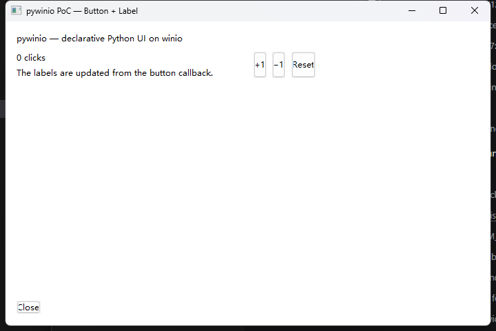

# pywinio

[winio](https://docs.rs/winio) 的 Python 绑定原型（pyo3）。

当前是 **PoC v0.1**：Python 声明组件树与布局，Rust 侧全自动接管 winio 的
`init` / `start` / `update` / `render` 生命周期，原生事件通过统一通道回调到 Python。
按计划不包含 WebView 与 `compio-compat`。



## 已实现

- 组件：`Button`、`Label`
- 布局：`StackPanel`（横/竖、spacing、padding、grow、对齐）、`Grid`（固定/auto/权重轨道、跨行跨列、gap），可任意嵌套
- 运行时：`label.text = ...` 等属性修改会投递到 UI 线程并触发重排
- 回调：`on_click=` 注册，自动接到 winio 的 `start`/`update`
- 关闭：标题栏关闭、`Close` 按钮回调 `app.quit()`、跨线程 `app.quit()` 均可用

## 快速开始（Windows）

环境：Rust nightly、Python 3.13、Windows 10/11（win32 后端）。

```powershell
# 如果 PowerShell 禁止执行脚本：
# Set-ExecutionPolicy -Scope Process Bypass

.\build.ps1 -Offline
$env:PYTHONPATH = "$PWD\python"
python .\examples\counter.py
```

自动关闭（用于验证/CI）：

```powershell
$env:PYWINIO_AUTOCLOSE_MS = "1500"; python .\examples\counter.py
```

> `-Offline` 与 `vendor/` 是本机环境的权宜之计：这里的 cargo/git 的 schannel
> TLS 栈无法连接 crates.io，所以 pyo3 以路径依赖方式内置。正常环境把
> `Cargo.toml` 中的 `pyo3` 改为 `pyo3 = "0.30.1"`，并删除 `[patch.crates-io]`
> 与 `vendor/` 即可。

## API 速览

```python
import pywinio as w

app = w.App("Counter", (640, 480))

root = app.stack(orient="vertical", spacing=8, padding=16)
counter = root.add_label("counter", "0 clicks")

def inc():
    counter.text = "1 clicks"   # 运行时改属性 -> 投递命令 -> 重排

root.add_button("inc", "+1", on_click=inc)

app.root = root
app.run()      # 阻塞；回调在 UI 线程执行
```

更完整的嵌套/Grid 示例见 [examples/counter.py](examples/counter.py)。

## 设计文档

架构、消息流、自动注册原理、布局算法、取舍与路线图：
[docs/design.md](docs/design.md)。

## 测试

```powershell
# 布局引擎单测（7 个）：用 --no-default-features 让测试二进制链接 libpython，
# 而不是按 extension-module 方式构建
cargo test --offline --no-default-features
```

## 仓库结构

```
src/lib.rs      pyo3 边界：App / StackPanel / Grid / Label / Button
src/model.rs    声明期数据模型、节点注册表、运行时 sender 表
src/widget.rs   AnyWidget：所有组件的统一 Component 实现（自动 start/update）
src/root.rs     PyRoot：窗口、动态子组件 fan-in、布局、事件分发
src/layout.rs   measure/arrange 两遍布局引擎（含单测）
python/         Python 包（加载构建出的 _pywinio.pyd）
examples/       counter.py
docs/           设计草案与截图
```
