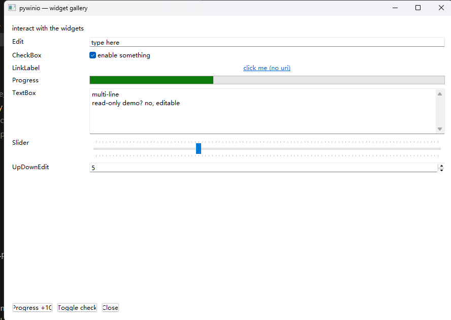
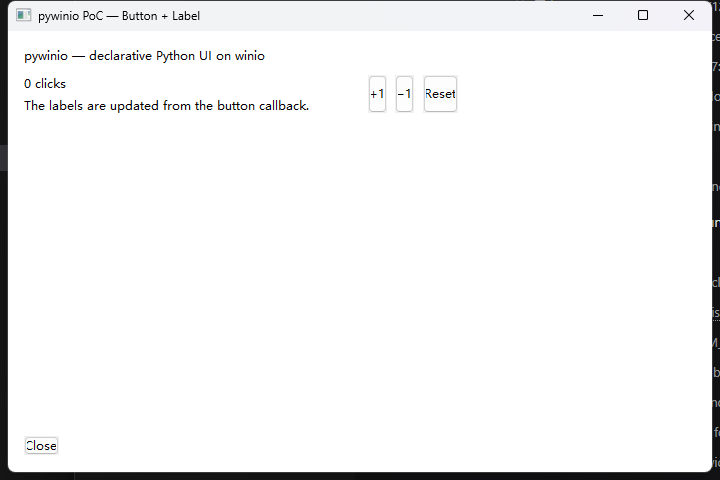

# pywinio 设计草案（PoC v0.1）

> 目标：验证「Python 声明组件与布局，Rust 侧全自动接管 winio ELM 生命周期」这条路线是否成立。
>
> 本文对应仓库中可运行的 PoC。设计依据：
> [winio 0.13.0-beta.3 widgets](https://docs.rs/winio/0.13.0-beta.3/winio/widgets/index.html)、
> [BoxComponent](https://docs.rs/winio/0.13.0-beta.3/winio/elm/struct.BoxComponent.html)、
> [StackPanel](https://docs.rs/winio/0.13.0-beta.3/winio/prelude/struct.StackPanel.html)、
> [Grid](https://docs.rs/winio/0.13.0-beta.3/winio/prelude/struct.Grid.html)、
> 以及 [winio-example/src/lib.rs](https://github.com/compio-rs/winio/blob/v0.13.0-beta.3/winio-example/src/lib.rs)。

---

## 0. 结论摘要

PoC 已验证以下核心判断：

1. **Python 只需要“声明 + 回调”**。原生 widget 由 `Component` 独占且 `!Send`，Python 不应直接持有；
   用「声明树 → 命令通道」即可安全地控制组件。
2. **`start`/`update` 可以做到完全自动**。所有组件共用一个 `Cmd`/`Evt` 类型对，
   由唯一的 `AnyWidget` 枚举实现 `Component`；Python 从不接触 `Child`、`ComponentSender`、`Root`。
3. **动态组件树可行**。`start!` 宏只能 join 编译期固定的子组件，但 `Child::start` 是普通 async fn，
   把 `N` 个 child 的 `start` future 收进 `Vec` 后 `select_all`，即可在运行时 fan-in 任意数量的子组件。
4. **嵌套布局不必依赖 `winio-layout`**。`StackPanel<'a, E>` 对子组件的可变借用在 `'a` 上贯穿整个生命周期，
   运行时递归构造“父 panel 持有子 panel”会遇到借用检查器/生命周期问题；
   PoC 改为自己实现 measure/arrange 两遍布局（纯函数、可单测），语义覆盖 StackPanel/Grid 的常用子集。
5. **GIL 模型成立**。`App.run()` 用 `Python::detach` 释放 GIL 并阻塞在 winio 事件循环；
   回调经 `Python::attach` 重新取 GIL，且都运行在 winio 事件循环（UI 线程）内；
   属性 setter / `quit()` 可从其他 Python 线程投递（channel + `PostMessage(WM_NULL)` 唤醒，
   实测 2.51s 触发、2.52s 返回）。

已用真实窗口验证：按钮点击 → Python 回调 → `label.text` 更新 → 原生控件刷新并重排；
窗口缩放后重新布局；标题栏关闭与 `app.quit()` 都能正常退出。

---

## 1. 范围

### 1.1 本版实现

| 类别 | 内容 |
| --- | --- |
| 组件 | `Button`、`Label`、`Edit`、`CheckBox`、`LinkLabel`、`Progress`、`TextBox`、`Slider`、`UpDownEdit` |
| 布局 | `StackPanel`、`Grid`、任意嵌套 |
| 交互 | `on_click` 回调；`text` / `visible` / `enabled` 运行时修改 |
| 生命周期 | 窗口创建、显示、关闭，全部由 Rust 驱动 |
| 打包 | maturin 构建 CPython wheel（mixed Rust/Python 布局） |
| 平台 | Windows + winio `win32` 后端（已实测） |

### 1.2 明确不做（本版）

- `webview`、`compio-compat`（按需求排除）。
- 菜单、工具栏、对话框、多窗口。
- 其余 widget（Edit、CheckBox、ComboBox、TabView、ScrollView、Progress…）。
- abi3 / 多 Python 版本 wheel、跨平台 CI（基础 maturin wheel 与 `.pyi` 已提供，见 §9.1）。

### 1.3 非目标（设计上不承诺）

- 让 Python 直接调用任意原生 widget 方法。
- 与 winio-layout（taffy）逐像素一致。
- 在多个线程上并发操作 UI。

---

## 2. winio 约束回顾

winio 0.13 的 ELM 模型（`winio::elm`）：

```rust
pub trait Component: Sized {
    type Init<'a>;
    type Message;
    type Event;
    type Error: Debug;

    async fn init(init: Self::Init<'_>, sender: &ComponentSender<Self>) -> Result<Self, Self::Error>;
    async fn start(&mut self, sender: &ComponentSender<Self>) -> !;       // 默认 pending
    async fn update(&mut self, msg: Self::Message, sender: &ComponentSender<Self>) -> Result<bool, Self::Error>;
    fn render(&mut self, sender: &ComponentSender<Self>) -> Result<(), Self::Error>;
    async fn update_children(&mut self) -> Result<bool, Self::Error>;
    fn render_children(&mut self) -> Result<(), Self::Error>;
}
```

几个直接影响绑定设计的事实：

1. **`Message`/`Event` 是编译期关联类型**。Python 无法为每个节点生成 Rust 类型，
   所以整个树必须收敛到一对固定的消息/事件类型（PoC 中的 `Cmd` / `Evt`）。
2. **`start!` 宏是 `join!`，子组件数量固定**。动态树不能照抄宏，必须自己 fan-in（见 §4.3）。
3. **`Child::start(sender, mapper)` 的 mapper 返回父组件的 `Message`，不是 `Event`**。
   因此“原生事件 → 父事件”需要经过一次 `Cmd` 中转（见 §4.2）。
4. **父组件的 `render` 不因子组件重绘而调用，只调用 `render_children`**。
   而我们的布局依赖子组件 `preferred_size`，所以布局必须放在 `render_children` 里重跑（见 §4.5）。
5. **widget 是 `!Send` 且由 `Component` 独占**。Python 持有的只能是代理句柄，操作必须转成消息投递。
6. **`Rect` 的 `width/height` 是方法不是字段**（euclid），PoC 已踩过此坑。

另外两个关键 API 事实：

- `Child<T>: DerefMut<Target = T>`，所以 `child.set_text(...)` 可直接调用内部 widget 的方法。
- `Child<T>: Layoutable`（当 `T: Layoutable`），但 **`BoxComponent` 只实现 `Component`，不实现 `Layoutable`**。
  这否决了“全部 `into_boxed()` 后统一存储”的方案——根组件无法给它们 `set_rect`。

---

## 3. 总体架构

```
┌──────────────────────────── Python 侧 ────────────────────────────┐
│  App / StackPanel / Grid / 9 种 widget  (pyo3 pyclass)             │
│  - 声明组件与初始属性                                              │
│  - 持有回调 (Py<PyAny>)                                            │
│  - setter: 改阴影属性 + Shared::post(cmd)                          │
└───────────────┬───────────────────────────────────────────────────┘
                │  app.run(): Python::detach
┌───────────────▼──────────────── Rust / winio 侧 ──────────────────┐
│  PyRoot : Component<Message = Msg, Event = Evt>                    │
│    ├─ Child<Window>                                                │
│    ├─ HashMap<NodeKey, Child<AnyWidget>>   （全部子组件）          │
│    ├─ Arc<LayoutSpec>                      （布局树）             │
│    └─ HashMap<NodeKey, Arc<WidgetNode>>    （回调查找）            │
│                                                                    │
│  AnyWidget : Component<Message = Cmd, Event = Evt>                 │
│    ├─ Button { child: Child<Button> }                              │
│    └─ Label  { child: Child<Label> }                               │
└────────────────────────────────────────────────────────────────────┘
```

### 3.1 三层职责

| 层 | 位置 | 职责 |
| --- | --- | --- |
| 声明层 | `python/` + `src/lib.rs` 的 pyclass | 建树、设初值、注册回调、改属性 |
| 桥接层 | `src/model.rs`、`src/widget.rs` | Node/布局数据、`Cmd`/`Evt`、统一 `Component` |
| 运行时层 | `src/root.rs`、`src/layout.rs` | 窗口、事件 fan-in、布局、回调分发 |

### 3.2 为什么不让 Python 直接操作 widget

- winio widget 绑定到创建它的线程（Win32 `HWND` 有线程亲和性），且类型 `!Send`。
- 若把原生指针交给 Python，任何线程、任何时刻都可能调用，Rust 侧无法保证生命周期与别名规则。
- ELM 模型要求状态修改发生在 `update` 中，才能正确触发重绘。

因此采用 **CQRS 风格**：读走 Python 侧的阴影属性，写走命令通道。

---

## 4. 自动 `start` / `update` 的实现

### 4.1 统一消息与事件

```rust
pub enum Cmd {              // 父 → 子
    SetText(String),
    SetEnabled(bool),
    SetVisible(bool),
    SetChecked(bool),       // CheckBox
    SetUri(String),         // LinkLabel
    SetPos(usize),          // Progress / Slider
    SetMinimum(usize),      // Progress / Slider / UpDownEdit
    SetMaximum(usize),
    SetIndeterminate(bool), // Progress
    SetValue(usize),        // UpDownEdit
    SetStep(usize),         // UpDownEdit
    Raise(Evt),             // 内部：把原生事件转成输出事件
}

pub enum Evt {              // 子 → 根
    Clicked(u64),           // Button / CheckBox / LinkLabel
    Changed(u64),           // Edit / Slider / UpDownEdit
    Closed,
    Resized,
}

pub enum Msg {              // 根组件自己的消息
    Event(Evt),
    Quit,
}
```

- `Cmd` 不需要携带节点 id：每个 widget 有独立 channel，post 到哪个 sender 就是发给哪个节点。
- `Evt` 带节点 id，因为根组件只收到一个汇聚流。
- `Clicked` 对应 `on_click` 回调，`Changed` 对应 `on_change` 回调。

### 4.2 `AnyWidget`：一个枚举承载所有 widget

```rust
pub enum AnyWidget {
    Button { node: Arc<WidgetNode>, child: Child<Button> },
    Label { child: Child<Label> },
    Edit { node: Arc<WidgetNode>, child: Child<Edit> },
    CheckBox { node: Arc<WidgetNode>, child: Child<CheckBox> },
    LinkLabel { node: Arc<WidgetNode>, child: Child<LinkLabel> },
    Progress { node: Arc<WidgetNode>, child: Child<Progress> },
    TextBox { node: Arc<WidgetNode>, child: Child<TextBox> },
    Slider { node: Arc<WidgetNode>, child: Child<Slider> },
    UpDownEdit { node: Arc<WidgetNode>, child: Child<UpDownEdit> },
}
```

`node` 只在需要读 id 或同步用户改动时保留；`Label` 没有事件，所以省略。

| widget | 原生事件 | 输出 |
| --- | --- | --- |
| Button / CheckBox / LinkLabel | Click | `Evt::Clicked(key)` |
| Edit / Slider / UpDownEdit | Change | `Evt::Changed(key)` |
| Label / Progress / TextBox | 无（空 Event 枚举） | — |
| Window | Close / Resize | `Evt::Closed` / `Evt::Resized` |

事件与更新的关键片段：

```rust
async fn start(&mut self, sender: &ComponentSender<Self>) -> ! {
    match self {
        Self::Button { node, child } => {
            let key = node.key;
            child.start(sender, move |event| match event {
                ButtonEvent::Click => Some(Cmd::Raise(Evt::Clicked(key))),
                _ => None,
            }).await
        }
        Self::Edit { node, child } => {
            let key = node.key;
            child.start(sender, move |event| match event {
                EditEvent::Change => Some(Cmd::Raise(Evt::Changed(key))),
                _ => None,
            }).await
        }
        Self::Label { child, .. } => child.start(sender, |_e: LabelEvent| None).await,
        // Progress / TextBox 同理：空事件，只启动原生监听
        // CheckBox / LinkLabel / Slider / UpDownEdit 分别映射 Click / Change
        ..
    }
}

async fn update(&mut self, cmd: Cmd, sender: &ComponentSender<Self>) -> Result<bool> {
    match cmd {
        Cmd::SetText(text) => { /* Button/Label/Edit/CheckBox/LinkLabel/TextBox */ Ok(true) }
        Cmd::SetChecked(v) => { /* CheckBox */ Ok(true) }
        Cmd::SetPos(v) => { /* Progress/Slider */ Ok(true) }
        Cmd::SetValue(v) => { /* UpDownEdit */ Ok(true) }
        Cmd::Raise(evt) => {
            self.sync_props();          // 用户改动 → 阴影属性
            sender.output(evt);         // 根组件收到 Evt
            Ok(false)
        }
        ..
    }
}
```

**要点：**

- `Child::start` 的 mapper 返回 `AnyWidget::Message = Cmd`，所以原生事件先变成
  `Cmd::Raise(Evt::...)` 投回自身；`update` 再 `sender.output(...)` 发给父组件。
- `AnyWidget` 额外实现 `Failable` + `Layoutable`，用 `dispatch_child!` 宏对 9 个 variant
  逐个委托给 `Child<W>`，这样根组件可以直接 `preferred_size()` / `set_rect()`。
- `sync_props` 在 `Cmd::Raise` 前把用户改动写回 `WidgetNode.props`：
  `Edit` 文本、`CheckBox.checked`、`Slider.pos`、`UpDownEdit.value`，因此回调里读到新值。
- `TextBox` 的 winio `TextBoxEvent` 为空，用户输入无法通知，`text` 只在 Python 设置时更新
  （已知限制，见 §10）。
- 新增 widget = 新 variant + init/start/update 分支 + Python class + 对应 `Cmd`；后续可用宏压缩。


### 4.2.1 备选方案：`into_boxed` + `BoxComponent`（未采用）

原型中也验证过另一条路：为每个 widget 写适配器，用 `Child::into_boxed()` 统一成
`HashMap<NodeKey, Child<BoxComponent<Cmd, Evt, Error>>>`。

不采用的原因：

- `BoxComponent` 只实现 `Component`，不实现 `Layoutable`；装箱后无法直接
  `preferred_size()` / `set_rect()`。必须额外维护 preferred size 缓存，并用 `Cmd::SetRect`
  命令下发矩形，布局链路更长。
- 每个 widget 仍需要一个适配器（原生 `Message`/`Event` 类型不同），并没有消除样板代码，
  只是把“枚举 + match”换成“多个 struct + 命令枚举”。
- 枚举方案可以直接对 `Child<AnyWidget>` 调用 `Layoutable`，布局在 `render_children` 中同步完成，
  对这个 PoC 更简单、更好调试。

若后续 widget 数量增大、单枚举的 match 难以维护，可以再回到适配器 + `into_boxed`，
届时配合宏生成适配器。

### 4.3 运行时子组件 fan-in

`start!` 宏展开为固定数量 future 的 `join!`，无法处理 `Vec<Child<_>>`。PoC 的做法：

```rust
async fn start(&mut self, sender: &ComponentSender<Self>) -> ! {
    let mut futures: Vec<Pin<Box<dyn Future<Output = ()> + '_>>> = Vec::new();

    let window_start = self.window.start(sender, |event| match event {
        WindowEvent::Close  => Some(Msg::Event(Evt::Closed)),
        WindowEvent::Resize => Some(Msg::Event(Evt::Resized)),
        _ => None,
    });
    futures.push(Box::pin(async move {
        let _: Infallible = window_start.await;   // 把 Output = ! 收敛为 ()
    }));

    for child in self.widgets.values_mut() {
        let child_start = child.start(sender, |event| Some(Msg::Event(event)));
        futures.push(Box::pin(async move {
            let _: Infallible = child_start.await;
        }));
    }

    match futures_util::future::select_all(futures).await {
        ((), _, _) => unreachable!("component start futures never complete"),
    }
}
```

细节：

- `Child::start` 返回 `!`。若直接写 `Pin<Box<dyn Future<Output = !>>>`，需要在类型位置命名 `!`
  （`never_type`，nightly 不稳定）。这里用 `let _: Infallible = fut.await;` 在强制转换点把 `!` 收为
  `Infallible`，async block 的输出自然变成 `()`，无需 feature gate。
- `select_all` 轮询所有 child；任一 future 完成即返回（实际永远不会）。
- future 借用了 `self.widgets` 的各个元素；`values_mut()` 产生不相交的 `&mut`，可同时存活到函数结束。
- 该方案对几十个组件足够；更多组件时可换成 `FuturesUnordered`，语义相同。

### 4.4 注册时序

```python
app = w.App(...)                 # 1. 创建 Shared（sender 表、id 生成器）
root = app.stack(...)            # 2. 创建 LayoutSpec
btn = root.add_button(...)       # 3. 创建 WidgetNode，挂到布局树
app.root = root                  # 4. 记录根布局
app.run()                        # 5. 进入 Rust
```

Rust 侧：

```text
PyApp::run
  ├─ layout::validate             # 结构校验（grid 越界、环、重复组件）
  ├─ collect_widgets              # DFS 收集 WidgetNode
  ├─ Python::detach
  │    ├─ winio::ui::App::builder().build()
  │    └─ App::block_on(async {
  │         ├─ Shared.runtime = Some(AppRuntime::default())
  │         ├─ Root::<PyRoot>::init(RootInit { ... })
  │         │    ├─ Child<Window>::init(())
  │         │    ├─ 逐节点 Child<AnyWidget>::init(AnyInit { node, parent: &window })
  │         │    ├─ 把每个 child.sender() 克隆进 Shared.runtime.senders
  │         │    └─ window.show()
  │         ├─ Shared.runtime.root = Some(root.sender().clone())
  │         └─ while let Some(event) = root.run().next().await { ... }
  │     })
```

关键点：

- **所有组件在窗口创建前就已“预注册”**（以纯数据 + 回调的形式），窗口初始化时按 DFS 顺序一次性创建原生控件。
- sender 在 `PyRoot::init` 内发布到 `Shared`；Python 句柄在回调中即可 `post`。
- `run()` 返回后 `Shared.runtime` 置空，句柄 setter 退化为只改阴影属性（避免向已销毁的组件投递）。
- 为支持 `maturin generate-stubs`，`_pywinio` 使用 `#[pymodule] mod` 内联声明，
  通过 `#[pymodule_export] use super::PyXxx` 导出 crate 根定义的 pyclass；
  函数式 `#[pymodule] fn` 无法被 pyo3 内省完整描述。

### 4.5 重排策略

winio 只会在 **父组件自身** 需要重绘时调用 `render`；子组件更新只会触发 `render_children`。
而 PoC 的布局依赖子组件 `preferred_size`（例如 `Label` 文本变化会影响尺寸），因此：

```rust
fn render_children(&mut self) -> Result<(), AppError> {
    let size = self.window.client_size()?;
    self.relayout(size)?;                 // 每次子组件重绘都重新 measure + arrange
    for child in self.widgets.values_mut() {
        child.render()?;
    }
    Ok(())
}
```

代价是每次子组件更新都做一次全树布局（O(N) + 原生文本测量）。
PoC 规模下可接受；优化方向见 §11（脏标记 / 增量布局）。

---

## 5. 布局子系统

### 5.1 为什么不用 winio-layout

`winio-layout` 的 panel 是“借用式”的：

```rust
pub struct StackPanel<'a, E> {
    children: Vec<StackPanelChild<'a, E>>,   // 每个元素持有 &'a mut dyn LayoutChild
    ...
}
impl<'a, E> StackPanel<'a, E> {
    pub fn push<'b>(&'b mut self, widget: &'a mut dyn LayoutChild<Error = E>) -> ...;
}
```

`StackPanel` 本身也实现 `LayoutChild`，理论上可以嵌套：
`outer.push(&mut inner_panel)`。但**父 panel 的 `set_size` 会递归驱动子 panel**，
所以 `inner_panel` 必须活到 `outer.set_size()` 结束。运行时递归写出来是这样：

```rust
fn build(node) -> &'a mut dyn LayoutChild {
    let mut panel = StackPanel::new(...);   // 局部变量
    for child in node.children {
        match child {
            Widget(w) => panel.push(w),
            Panel(p)  => panel.push(build(p)),   // inner 在递归返回后仍是局部变量
        }
    }
    &mut panel   // ❌ 返回局部变量引用；且 inner 已被 drop
}
```

- 递归返回时，内层 panel 已被 drop，外层却仍持有它的 `&mut`；
- 即使把 panel 塞进 `Vec<Box<...>>`，在持有 `&mut` 的同时继续 `push` 也会触发借用冲突；
- 要表达“任意深度、所有 panel 同时存活”，需要 arena（`typed-arena` / 自建 unsafe bump arena）
  或上游提供 owned 的 builder API。

PoC 的取舍：**自己实现布局引擎**。优点是全安全代码、运行时可测、与 Python API 一致；
缺点是语义只覆盖 winio-layout 的子集（见 §5.5）。

### 5.2 数据模型

```rust
pub enum LayoutKind {
    Stack { orient: Orient, spacing: f64, padding: Edges },
    Grid  {
        columns: Vec<Track>, rows: Vec<Track>,
        col_gap: f64, row_gap: f64, padding: Edges,
    },
}

pub enum Track { Fixed(f64), Auto, Weight(f64) }   // "120" / "auto" / "1*"

pub struct ItemOpts {
    grow: bool,
    margin: Edges,
    halign: HAlign, valign: VAlign,
    width: Option<f64>, height: Option<f64>,
    row: usize, col: usize, row_span: usize, col_span: usize,
}

pub enum Elem {
    Widget(Arc<WidgetNode>),
    Panel(Arc<LayoutSpec>),      // 嵌套
}
```

`LayoutSpec::items` 放在 `Mutex<Vec<_>>` 里，允许 Python 在容器被嵌套后继续 append；
`Arc` 同时被布局树、Python 句柄、根组件共享，生命周期自动管理。

### 5.3 Pass 1：measure

从根向下 DFS：

- 叶子：调用原生 `preferred_size()`（`Button`/`Label` 由 winio 后端实测文本/字体）。
- Stack：主轴 = Σ(子主轴 + 主轴 margin) + spacing×(n-1) + padding；交叉轴 = max(子交叉轴 + margin)。
- Grid：
  1. 单 span 项决定 auto 轨道的内容尺寸；
  2. 跨 span 项若超出已解析轨道之和，把差额均摊给它跨过的 auto/weight 轨道；
  3. **measure 阶段 weight 轨道按内容尺寸计**（否则嵌套的权重 Grid 会报告 0 尺寸而“消失”），
     arrange 阶段才按剩余空间分配。
- 结果缓存到 `Measured { widgets, panels }`，供 arrange 使用。

### 5.4 Pass 2：arrange

- Stack 主轴：先按 preferred + margin 铺满，`grow` 子项均分剩余空间；
  交叉轴按 `halign`/`valign` 拉伸或对齐。
- Grid：固定/auto 轨道先定，剩余空间按权重分配；cell 矩形含 span 与 gap；
  子项在 cell 内按 margin + 对齐 + 显式宽高放置。
- 递归容器时直接把子 rect 传下去，**不需要借用父 panel**，因此没有 §5.1 的生命周期问题。

两个 pass 都是纯函数（measure 只接受一个 `FnMut(key) -> Size` 闭包，arrange 只返回
`Vec<(key, Rect)>`），所以能在无窗口环境下单测。

### 5.5 与 winio-layout 的差异

| 能力 | winio-layout (taffy) | pywinio PoC |
| --- | --- | --- |
| Stack grow | ✅ | ✅（均分剩余） |
| Stack spacing | 需用 margin 模拟 | ✅ 原生 `spacing` |
| Grid 固定/auto/权重轨道 | ✅ | ✅ |
| row/col span | ✅ | ✅ |
| 跨轴对齐 / margin | ✅ | ✅ |
| min/max 尺寸 | ✅ | ❌ 仅显式 width/height |
| shrink / 溢出处理 | ✅ | ❌ 直接按计算值放置，超出即裁剪 |
| Grid 自动放置 | ❌ | ❌ 需显式 row/col |
| RTL / baseline | taffy 支持 | ❌ |
| 每边独立 padding（Python API） | n/a | ❌ 仅统一 padding |

对 PoC 的 UI 来说这些差异不影响结论；若后续要求像素级对齐 winio，
建议的迁移路径见 §11.2。

---

## 6. Python API

### 6.1 完整示例

```python
import pywinio as w

app = w.App("pywinio PoC — Button + Label", (720, 480))

root = app.stack(orient="vertical", spacing=12, padding=16)
header = root.add_label("header", "pywinio — declarative Python UI on winio")

grid = app.grid(columns="1*,1*", rows="auto", col_gap=16)
root.add(grid, grow=True)

left = grid.add_stack(orient="vertical", spacing=6, row=0, col=0)
counter = left.add_label("counter", "0 clicks")
left.add_label("hint", "The labels are updated from the button callback.")

right = grid.add_stack(orient="horizontal", spacing=8, row=0, col=1)

def add(delta):
    global clicks
    clicks += delta
    counter.text = f"{clicks} clicks"     # 运行时属性修改

right.add_button("inc", "+1", on_click=lambda: add(1))
right.add_button("dec", "−1", on_click=lambda: add(-1))

app.root = root
app.run()
```

新组件通过 `App` 工厂创建，再用通用 `add` 放进布局（完整示例见 `examples/gallery.py`）：

```python
edit = app.edit("name", "type here", on_change=refresh_status)
check = app.check_box("opt", "enabled", checked=True, on_click=refresh_status)
slider = app.slider("speed", pos=30, maximum=100, on_change=refresh_status)

grid.add(edit, row=0, col=1)
grid.add(check, row=1, col=1)
grid.add(slider, row=2, col=1)
```

### 6.2 API 表

**App**

| 成员 | 说明 |
| --- | --- |
| `App(title, size=(720, 480))` | 创建应用；此时尚未创建窗口 |
| `app.stack(orient="vertical", spacing=0.0, padding=0.0)` | 创建根/独立 StackPanel |
| `app.grid(columns="", rows="", col_gap=0.0, row_gap=0.0, padding=0.0)` | 创建 Grid |
| `app.edit(id, text="", *, on_change=None)` | 创建 Edit |
| `app.check_box(id, text="", checked=False, *, on_click=None)` | 创建 CheckBox |
| `app.link_label(id, text="", uri="", *, on_click=None)` | 创建 LinkLabel |
| `app.progress(id, pos=0, minimum=0, maximum=100, indeterminate=False)` | 创建 Progress |
| `app.text_box(id, text="")` | 创建 TextBox |
| `app.slider(id, pos=0, minimum=0, maximum=100, *, on_change=None)` | 创建 Slider |
| `app.up_down_edit(id, value=0, minimum=0, maximum=100, step=1, *, on_change=None)` | 创建 UpDownEdit |
| `app.root = panel` | 指定根布局；必须在 `run()` 前 |
| `app.run()` | 阻塞运行；释放 GIL；必须主线程调用 |
| `app.quit()` | 请求关闭；可从其他线程调用 |
| `app.running` | 是否在运行 |

**StackPanel**

| 成员 | 说明 |
| --- | --- |
| `add(child, *, grow=False, margin=None, halign="stretch", valign="stretch", width=None, height=None)` | 添加 widget 或嵌套容器 |
| `add_label(id, text)` / `add_button(id, text, *, on_click=None)` | 创建并添加 |
| `add_stack(orient="vertical", spacing=0.0, padding=0.0)` | 创建嵌套 StackPanel 并添加 |
| `add_grid(columns="", rows="", ...)` | 创建嵌套 Grid 并添加 |

**Grid**

| 成员 | 说明 |
| --- | --- |
| `add(child, *, row=0, col=0, row_span=1, col_span=1, margin=None, halign=..., valign=..., width=None, height=None)` | 按格子放置 |
| `add_label(id, text, *, row=0, col=0, row_span=1, col_span=1)` | 创建并放置 |
| `add_button(id, text, *, on_click=None, row=0, col=0, ...)` | 同上 |
| `add_stack(orient=..., ..., *, row=0, col=0, ...)` | 嵌套容器 |
| `rows` / `columns` | 轨道数量 |

**Widget 属性**

工厂方法返回的 widget 通过 `container.add(widget, ...)` 加入布局（见 `examples/gallery.py`）。

| 属性 | Button | Label | Edit | CheckBox | LinkLabel | Progress | TextBox | Slider | UpDownEdit |
| --- | --- | --- | --- | --- | --- | --- | --- | --- | --- |
| `id` | ✅ | ✅ | ✅ | ✅ | ✅ | ✅ | ✅ | ✅ | ✅ |
| `text` | ✅ | ✅ | ✅ | ✅ | ✅ | — | ✅ | — | — |
| `visible` | ✅ | ✅ | ✅ | ✅ | ✅ | ✅ | ✅ | ✅ | ✅ |
| `enabled` | ✅ | — | ✅ | ✅ | ✅ | ✅ | ✅ | ✅ | ✅ |
| `checked` | — | — | — | ✅ | — | — | — | — | — |
| `uri` | — | — | — | — | ✅ | — | — | — | — |
| `pos` | — | — | — | — | — | ✅ | — | ✅ | — |
| `minimum` / `maximum` | — | — | — | — | — | ✅ | — | ✅ | ✅ |
| `indeterminate` | — | — | — | — | — | ✅ | — | — | — |
| `value` / `step` | — | — | — | — | — | — | — | — | ✅ |
| `on_click` | ✅ | — | — | ✅ | ✅ | — | — | — | — |
| `on_change` | — | — | ✅ | — | — | — | — | ✅ | ✅ |
| `__repr__` | ✅ | ✅ | ✅ | ✅ | ✅ | ✅ | ✅ | ✅ | ✅ |

所有属性均可在运行中读写；setter 会投递 `Cmd`，回调中读到的阴影属性已由 `sync_props` 同步。

### 6.3 语义约定

- **预注册**：所有组件必须在 `run()` 前创建并挂到布局树；`run()` 之后新增布局不会被创建。
- **回调零参数**：`on_click()` / `on_change()` 不传事件对象；需要区分来源时用闭包捕获句柄（见示例）。
- **回调线程**：始终在 UI 线程执行；回调里可直接读写其他句柄。
- **异常**：回调抛出的 Python 异常由 `PyErr::print` 打印，不终止 UI 循环。
- **句柄跨线程**：属性 setter / `quit()` 是线程安全的投递；`run()` 自身必须主线程。
- **不可达组件**：创建了但未加入布局树的组件不会被原生创建（当前静默跳过；见 §10）。

---

## 7. 线程、GIL 与唤醒

### 7.1 线程模型

```
Python 主线程                          UI 线程（同一个 OS 线程）
     │
     ├─ app.run() ── py.detach ──────────► winio App::block_on
     │                                       ├─ poll 主 task
     │                                       ├─ MsgWaitForMultipleObjectsEx
     │                                       └─ 回调时 Python::attach
     │
     └─ 其他线程: label.text = ... ──► Channel<Cmd> ──► waker.wake()
                                                    └─ PostMessage(hwnd, WM_NULL)
```

- winio 是单线程运行时；`run()` 在 Python 主线程上阻塞，正好符合 Win32 消息循环的线程要求。
- `Python::detach` 保证其他 Python 线程仍可运行（例如定时器线程调用 `app.quit()`）。
- `ComponentSender<T>` 内部是 `Arc<Mutex<Channel<T>>>`，`post()` 可从任意线程调用；
  `Channel::send` 会取走并 `wake()` 已注册的 waker。
- win32 后端的 waker 是 `ApcWaker`：`GetCurrentThread` 的句柄 + `NtAlertThread`，
  配合 `MsgWaitForMultipleObjectsEx(..., MWMO_ALERTABLE)`。实测仅依赖它时，
  跨线程唤醒不够及时；因此 `Shared::post/quit` 在 post 之后额外
  `PostMessageW(hwnd, WM_NULL, 0, 0)`，这是唤醒 Win32 消息循环的标准做法。
  实测：定时器 2.51s 触发，`run()` 2.52s 返回。

### 7.2 GIL 与锁

- 回调中 `Python::attach` 取 GIL；回调返回后释放。
- **绝不在持有 Rust 锁时调用 Python**：`invoke_click` 先 clone `Py<PyAny>` 并释放 `MutexGuard`，
  再 `call0()`。否则回调里设置同一节点的 `on_click` 会自死锁。
- Python setter 只短暂持有 `props` 锁和 `runtime` 锁，不回调 Python。

### 7.3 关闭路径

| 来源 | 流程 |
| --- | --- |
| 标题栏 × | `WindowEvent::Close` → `Msg::Event(Closed)` → `window.hide()` → `sender.output(Evt::Closed)` |
| 按钮回调 `app.quit()` | `Shared::quit()` → `Msg::Quit` → 同上 |
| 其他线程 `app.quit()` | 同上，经 `PostMessage` 唤醒 |
| `App.run` 主循环 | 收到 `Evt::Closed` → 退出 `while` → drop `Root` → 销毁原生窗口 |

---

## 8. 错误处理与校验

| 阶段 | 检查 | Python 异常 |
| --- | --- | --- |
| 构造 | size 必须为正 | `ValueError` |
| `add` | 子对象必须是已支持的 widget 或 StackPanel/Grid | `TypeError` |
| `add` | Grid 越界 | `ValueError` |
| `add` | 容器不能包含自身 | `ValueError` |
| `run` | 未设置 `app.root` | `RuntimeError` |
| `run` | Grid span 越界、布局环、组件重复 | `ValueError` |
| `run` | winio 初始化/运行失败 | `RuntimeError`（含原始错误字符串） |
| 回调 | Python 异常 | 打印 traceback，继续运行 |
| 更新/渲染 | winio 错误 | `RunEvent::UpdateErr/RenderErr` 打印，继续运行 |

Rust 侧统一错误：

```rust
pub enum AppError {
    Winio(winio::Error),
    Layout(String),
}
```

---

## 9. PoC 验证记录

环境：Windows 11、Rust nightly 1.101、Python 3.13.17、
winio 0.13.0-beta.3（`default-features = false, features = ["win32"]`）、pyo3 0.30.1。

### 9.1 构建与单测

```powershell
cargo build --offline
# Finished `dev` profile ... （无 warning）

cargo test --offline --no-default-features
# running 7 tests ... test result: ok. 7 passed; 0 failed
```

布局单测覆盖：Stack 交叉轴拉伸、grow 均分、Grid 权重、auto 行、嵌套、跨列含 gap、
margin + 居中对齐。测试二进制用 `--no-default-features` 关闭 `extension-module`，
以便链接 libpython。

### 9.1.1 Wheel 构建与 `.pyi`

maturin 1.16.0 + `pyproject.toml`（mixed Rust/Python 布局）：

```powershell
# 由 #[pymethods] 内省生成 python/pywinio/_pywinio.pyi
maturin generate-stubs --out python --interpreter python --offline

# 普通 build 会把已提交的 stub 一起打进 wheel
maturin build --release --offline
# 或：.\build-wheel.ps1 -Offline（会先刷新 stub）
# 📦 Built wheel ... target\wheels\pywinio-0.1.0-cp313-cp313-win_amd64.whl
```

wheel 内容：

```text
pywinio/__init__.py
pywinio/_pywinio.cp313-win_amd64.pyd
pywinio/_pywinio.pyi
pywinio/py.typed
pywinio-0.1.0.dist-info/METADATA
pywinio-0.1.0.dist-info/WHEEL
pywinio-0.1.0.dist-info/RECORD
```

把 wheel 解压到独立目录并 `PYTHONPATH` 指向它后，`import pywinio` 与
`examples/counter.py` 均正常运行；pyright 对 `_pywinio.pyi` 的检查为
`0 errors`。

> maturin 的内省只支持 `#[pymodule] mod` 内联模块。函数式 `#[pymodule] fn`
> 会被标记为不完整（生成 `def __getattr__(name): ...`），无法得到完整 stub。
> 因此 `_pywinio` 使用内联模块 + `#[pymodule_export] use super::PyXxx`，
> 并在 `Cargo.toml` 打开 pyo3 的 `experimental-inspect` feature。

### 9.2 真实窗口

运行 `examples/gallery.py`，9 种 widget 全部创建成功，截图如下：



运行 `examples/counter.py` 验证布局/回调链路：



### 9.3 事件链路

用 Win32 消息模拟用户操作（避免人工交互）：

- **Button**：`BM_CLICK` 两次 `+1`、一次 `Reset`，原生 Static 文本依次为
  `1 clicks` / `2 clicks` / `0 clicks`，header 同步更新。
- **Edit**：向 Edit 发送 `WM_SETTEXT`，状态标签变为 `edit='typed'`，证明
  `EditEvent::Change` → `Evt::Changed` → `on_change` → `sync_props` 生效。
- **CheckBox**：`BM_CLICK` 后原生 `BM_GETCHECK` 从 1 变 0，回调中的 `check.checked`
  已是 `False`。
- **LinkLabel**：向 Static 发送 `WM_LBUTTONDOWN/UP`，`links` 从 0 变 1，`on_click` 触发。
- **Slider**：`TBM_SETPOS` 设为 80 后，向 winio 内层窗口发送 `WM_HSCROLL`，
  状态标签变为 `slider=80`。注意消息要发给
  `WinioWindowVersion…` 子窗口（widget 的真正 parent），而不是顶层标题栏窗口。
- **Progress**：初始 `PBM_GETPOS=35`，点击 `Progress +10` 后为 45，状态标签同步。
- **UpDownEdit**：初始值 5 在回调状态中可见；用户点击/输入走 winio 的
  `WM_COMMAND(EN_CHANGE)` 路径。

### 9.4 其他路径

- **窗口缩放**：720×480 时 `+1` 客户区 x=368；缩放到 920×620 后 x=468，
  与 `padding=16 + 权重列 + gap=16` 的计算一致，说明 `Resize` → 根组件 `render` →
  `render_children` → 重新布局生效。
- **WM_CLOSE**：`PostMessage(WM_CLOSE)` 后窗口句柄消失、`run()` 返回。
- **跨线程 `quit()`**：定时器 2.51s 触发，`run()` 2.52s 返回（`PostMessage` 唤醒生效）。
- **跨线程 setter**：worker 线程在 1.2s 设置 `label.text`，2.8s 读取原生 Static 文本已是新值。
- **注意**：示例里的 `threading.Timer` 必须设 `daemon = True`，否则 Python 解释器会等待
  定时器线程结束，表现为“窗口已关但进程不退出”——这是 Python 线程语义，不是绑定 bug。

---

## 10. 已知限制（按严重度）

1. **其余 widget 未支持**：ComboBox、ListBox、TabView、ScrollView、Picture、Canvas、菜单/对话框等
   仍需扩展 `AnyWidget` 与 `Cmd`。
2. **布局语义不完整**：无 min/max/shrink/RTL/自动放置；见 §5.5。复杂界面可能溢出或裁剪。
3. **全量重排**：任何子组件更新都重建 measure/arrange；组件多时可能掉帧。
4. **无属性绑定**：只能命令式 setter；没有 `Prop`/observable 集成。
5. **回调无事件对象**：`on_click()` 零参；无法直接拿到点击坐标、键盘修饰键等。
6. **不可达组件静默跳过**：无“已注册但未布局”的告警/校验。
7. **无多窗口/菜单/对话框**：`Window` 只有一个，`MessageBox`/`FileBox` 未接入。
8. **打包限制**：wheel 仍是 `cp313` 专用（未启用 abi3），没有多版本 wheel 与跨平台打包；
   `.pyi` 与 `py.typed` 已提供（由 maturin 内省生成，见 §9.1.1）。
9. **仅 Windows 实测**：winio 的 GTK/Qt/AppKit 后端未验证；布局引擎本身平台无关。
10. **回调异常只打印**：没有错误上报钩子，也不阻止后续回调。
11. **布局树在 run 后仍可被 Python 修改**（`Arc` + `Mutex`），但 UI 线程只读取快照语义，
    结果未定义；应在文档/运行时禁止。
12. **`Label.enabled` 未暴露**（winio `Label` 本身不实现 `Enable`）。
13. **TextBox 用户输入不可观测**：winio 0.13 的 `TextBoxEvent` 为空，用户键入不会触发回调，
    `text` 只在 Python setter 时更新；Edit 则通过 `Change` 事件正常同步。
14. **LinkLabel 的 `uri` 语义**：`uri` 非空时点击由系统打开链接，且 winio 不再触发 `Click`，
    因此 `on_click` 不会执行。
15. **Slider 程序化赋值可能回调**：winio 的 `set_pos` 使用 `TBM_SETPOSNOTIFY`，
    设置 `slider.pos` 可能触发一次 `on_change`；回调里不要无条件再次设置 `pos`，避免自激。
16. **UpDownEdit 初值读取**：原生 up-down 控件未就绪时 `value()` 可能失败，
    `sync_props` 会保留旧阴影值（不会崩溃）。

---

## 11. 后续路线

### 11.1 v0.2：组件与交互

- 扩展 widget：`ComboBox`、`ListBox`、`TabView`、`ScrollView`、`Picture`、`Canvas`、菜单与对话框。
- 每个新 widget 加一个 `AnyWidget` variant + `Cmd` 变体；数量继续增长时可用宏生成。
- 回调携带事件对象：`on_click(event)`；至少提供 `node_id`、可选坐标/键状态。
- `App.start()` 非阻塞 + `App.wait()`，便于和 asyncio/线程结合。
- 属性级绑定：把 winio 的 `Prop`/`bind` 暴露为 Python 可观察对象（注意 GIL 成本与合并）。

### 11.2 v0.3：布局对齐

三个候选方案，按推荐度排序：

1. **上游化**：给 winio-layout 增加 owned/dynamic builder（`PanelNode` 树，内部 arena），
   pywinio 直接复用 taffy 语义。最理想，但依赖上游。
2. **arena 适配层**：用 `typed-arena`（或 30 行 unsafe bump arena）让所有 panel 同时存活，
   再调用 `winio_layout::StackPanel/Grid`。语义最接近，代价是一处受控 unsafe。
3. **增强自研引擎**：补 min/max、shrink、baseline、RTL、自动放置；纯安全但工作量大，
   且永远难以与 taffy 逐像素一致。

同时补：每边独立 padding、Grid 自动放置、布局脏标记/增量 measure。

### 11.3 v1.0：工程化

- abi3 / 多 Python 版本 wheel；Sphinx/mkdocs 文档。
- 跨平台 CI（Windows win32 / Linux gtk / macOS app-kit）。
- 运行时校验：所有已注册组件必须可达；重复/悬空引用告警。
- API 稳定性与版本策略（跟随 winio 0.x 的 breaking change）。

---

## 12. 风险与开放问题

| 风险 | 影响 | 缓解 |
| --- | --- | --- |
| winio 仍为 beta，`Component`/宏可能变动 | 绑定层需跟进 | 把 winio 依赖集中在 `widget.rs`/`root.rs`；锁版本 |
| 自研布局与 taffy 不一致 | 视觉差异 | 明确子集语义；按 §11.2 迁移 |
| 全量重排 | 大 UI 卡顿 | 脏标记、按子树 measure、缓存文本尺寸 |
| GIL + detach 的线程约束 | 误用导致卡死/崩溃 | 文档 + 运行时 `running`/线程检查 |
| 回调异常被吞 | 难调试 | 增加 `App.on_error` / 日志钩子 |
| `select_all` 的 O(N) 轮询开销 | 组件多时 CPU 占用 | 换 `FuturesUnordered`，本质仍是 O(事件) |
| 跨平台后端差异（DPI/字体） | 布局尺寸不同 | CI 截图回归；逻辑单位由 winio 统一 |

开放问题：

1. Python 布局方言是否要严格镜像 winio-layout，还是定义一套更稳定的自有语义？
2. 事件应该用统一 `Evt` + payload，还是每个 widget 一个 typed event？
3. `run()` 阻塞模型是否满足目标用户，还是应该默认后台线程 + `wait()`？
4. 属性绑定用 winio `Prop` 还是 Python 侧 observable 批量同步？
5. 组件创建是“全部预创建”还是支持运行时挂载/卸载（需要 `Child` 的动态增删能力）？

---

## 附录 A：文件结构

```
Cargo.toml            cdylib + pyo3 0.30（experimental-inspect）+ winio 0.13（win32）
pyproject.toml        maturin / PEP 621 元数据（mixed Rust/Python 布局）
build.ps1             构建并把 DLL 拷成 python/pywinio/_pywinio.pyd
build-wheel.ps1       刷新 stub 并构建 CPython wheel（target/wheels）
src/lib.rs            pyclass：App / 容器 / 9 种 widget；参数解析与校验
src/model.rs          WidgetNode、LayoutSpec、Track、Shared/AppRuntime、collect_widgets
src/widget.rs         AnyWidget（统一 Component 实现）、Cmd/Evt
src/root.rs           PyRoot（窗口、fan-in、重排、回调分发）、run_app
src/layout.rs         measure/arrange/validate + 7 个单测
python/pywinio/       Python 包入口、_pywinio.pyi、py.typed
examples/             counter.py、gallery.py
docs/design.md        本文
```

## 附录 B：关键代码索引

| 主题 | 位置 |
| --- | --- |
| 动态 fan-in | `src/root.rs` `PyRoot::start` |
| 统一组件 | `src/widget.rs` `impl Component for AnyWidget` |
| 重排策略 | `src/root.rs` `render_children` / `relayout` |
| 布局算法 | `src/layout.rs` `measure` / `arrange` |
| 命令投递 | `src/model.rs` `Shared::post` |
| 跨线程唤醒 | `src/model.rs` `Shared::wake`（`PostMessageW(WM_NULL)`） |
| Python setter | `src/lib.rs` `PyLabel::set_text` 等 |
| 校验 | `src/layout.rs` `validate`、`src/model.rs` `collect_widgets` |
| 类型存根 | `maturin generate-stubs` → `python/pywinio/_pywinio.pyi` |
| Wheel 构建 | `pyproject.toml`、`build-wheel.ps1` |
